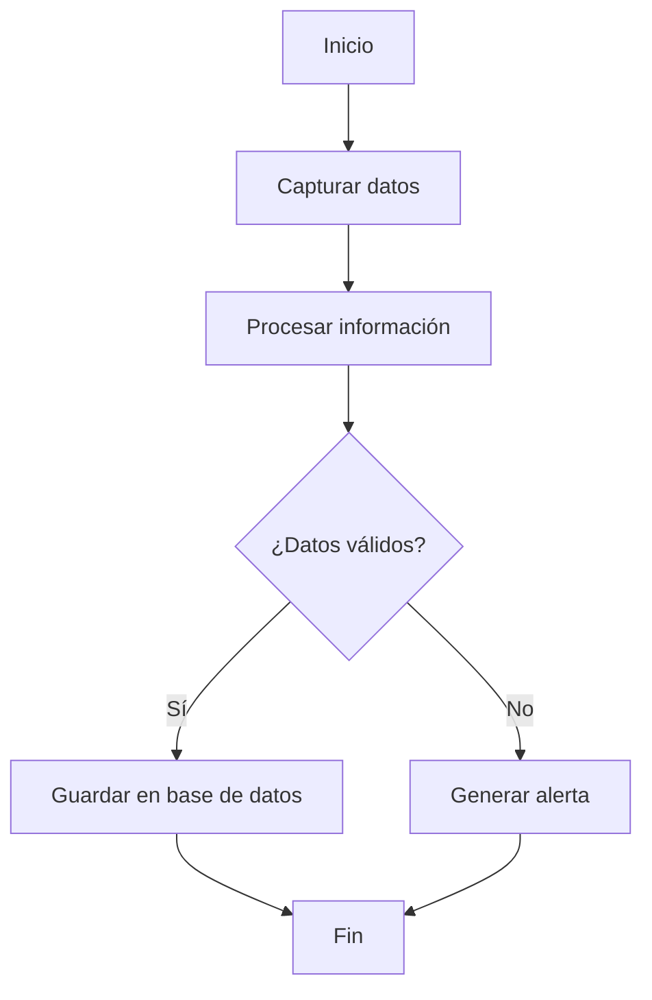
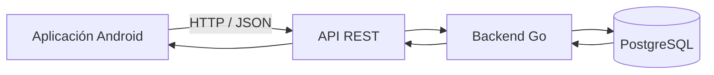
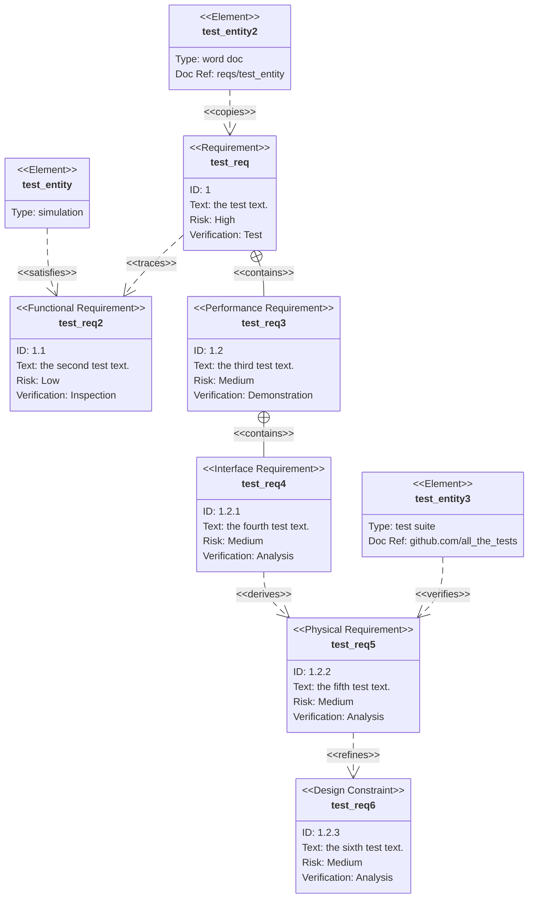

# Introducción a Markdown y Mermaid

## 1. Objetivo

Este documento presenta los fundamentos de Markdown y Mermaid para crear documentación técnica, diagramas de flujo y arquitecturas de software.

## 2. ¿Qué es Markdown?

Markdown es un lenguaje de marcado ligero que permite crear documentos estructurados mediante texto plano.

Ejemplos de sintaxis:

- `# Título principal`
- `## Subtítulo`
- `**Texto en negrita**`
- `*Texto en cursiva*`
- `- Elemento de lista`

## 3. ¿Qué es Mermaid?

Mermaid permite generar diagramas mediante código textual.

En lugar de dibujar manualmente, se describen los componentes y sus relaciones.

## 4. Primer diagrama Mermaid

## 5. Explicación de la sintaxis

| Código | Función |
|---|---|
| `flowchart TD` | Diagrama de flujo vertical |
| `A` | Identificador del nodo |
| `[Texto]` | Nodo rectangular |
| `-->` | Conexión con flecha |
| `{Texto}` | Nodo de decisión |
| `\|Sí\|` | Etiqueta de una conexión |

## 6. Ejemplo de arquitectura de software

## 7. Conclusión

Markdown permite estructurar documentación técnica y Mermaid facilita la representación visual de procesos, sistemas y arquitecturas.

Ambos pueden utilizarse dentro de repositorios Git para mantener documentación versionada y editable.

